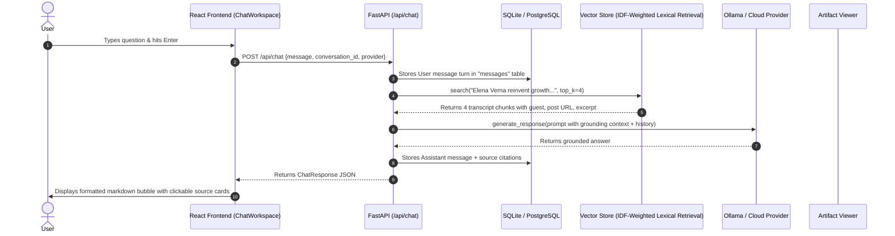

# Beginner's Architectural & Code Learning Guide
## The Lenny Growth Assistant

Welcome! This guide is written specifically for you if you are learning full-stack AI development. You can use it to study, understand, and explain the architecture during an engineering evaluation.

---

## 1. Which Files to Study First (Recommended Reading Order)

To build intuition without feeling overwhelmed, explore the codebase in this order:

1. **`backend/app/models/schemas.py`**: Understand the data contracts (what goes in, what comes out of every API).
2. **`backend/app/models/db_models.py`**: Understand the database tables (`conversations`, `messages`, `artifacts`).
3. **`backend/app/rag/chunker.py`**: Understand how raw podcast text is chopped into overlapping chunks.
4. **`backend/app/rag/vector_store.py`**: Learn how the persisted feature-hash matrix is built and why live retrieval uses IDF-weighted token overlap to reject unrelated matches.
5. **`backend/app/providers/base.py` & `backend/app/providers/ollama_provider.py`**: See how LLM calls are abstracted so you can swap models without touching business logic.
6. **`backend/app/agent/runner.py`**: See how the agent decides whether a question needs Q&A, an essay, or an HTML artifact.
7. **`backend/app/agent/essay_skill.py`**: Examine how Dickie Bush & Nicolas Cole's Ship 30 for 30 writing framework is codified into software.
8. **`frontend/src/components/artifacts/SandboxedIframe.tsx`**: Learn how security isolation prevents malicious or model-generated HTML from compromising the app.
9. **`frontend/src/App.tsx`**: See how the React frontend coordinates state between the sidebar, chat workspace, and artifact viewer.

---

## 2. Directory Structure and Purpose

```
The Lenny Growth Assistant/
├── backend/
│   ├── alembic/             # Database migration scripts (version control for database tables)
│   ├── app/
│   │   ├── api/             # HTTP route controllers (FastAPI)
│   │   ├── core/            # Configuration (.env), database connection, structured logging
│   │   ├── models/          # SQLAlchemy database tables & Pydantic validation schemas
│   │   ├── providers/       # LLM provider abstraction (Ollama, OpenAI, Anthropic, Mock)
│   │   ├── rag/             # RAG pipeline: chunking, embeddings, vector indexing, retrieval
│   │   ├── agent/           # Agent orchestration, prompts, Ship 30 essay engine
│   │   └── main.py          # FastAPI application entry point
│   ├── tests/               # Pytest automated test suite (13 test cases)
│   └── requirements.txt     # Python dependencies
├── frontend/
│   ├── src/
│   │   ├── components/      # Reusable React components (Sidebar, Chat, Artifacts, UI)
│   │   ├── services/        # Clean API client wrapper (fetch calls to backend)
│   │   ├── types/           # TypeScript data interfaces matching backend schemas
│   │   ├── App.tsx          # Top-level workspace layout and state coordinator
│   │   └── main.tsx         # React root mounting point
│   └── package.json         # Frontend dependencies and build scripts
├── data/
│   ├── transcripts/         # 50 real podcast transcripts (Markdown files with frontmatter)
│   └── index/               # Runtime-generated index; ignored by Git due source license
├── docker-compose.yml       # Multi-container orchestration (PostgreSQL, Backend, Frontend)
├── .env.example             # Configuration reference template
├── PRD.md                   # Product Requirements Document
├── architecture.md          # System Architecture & Technical Specifications
└── design.md                # UI/UX Design System Specification
```

---

## 3. How a Message Travels: End-to-End Request Lifecycle

Follow this trace when a user types: *"How does Elena Verna reinvent growth loops for AI products?"*



---

## 4. How the RAG Knowledge System Works

RAG stands for **Retrieval-Augmented Generation**. Here is how our implementation works without unnecessary complexity:

1. **Frontmatter Parsing:** Each file in `data/transcripts/` starts with YAML headers (`title`, `guest`, `date`, `post_url`). `app/rag/chunker.py` extracts these headers and preserves them.
2. **Chunking with Overlap:** Transcripts can be 15,000 words long. Large documents cannot fit comfortably into smaller local model context windows. We split the transcript into ~400-word chunks with a 60-word overlap so sentences crossing boundaries aren't severed.
3. **Feature hashing:** Ingestion stores a 512-dimensional hash-feature vector per chunk for lightweight local experiments. Feature hashing is not a pretrained semantic model and can produce collisions.
4. **Evidence-aware retrieval:** At query time, the service tokenizes the question and transcript chunks, weights informative terms by inverse document frequency, and scores the fraction of query evidence found in each chunk. This is explainable lexical similarity, not semantic understanding; unsupported questions should abstain.
   $$\text{similarity} = \vec{A} \cdot \vec{B}$$
   The chunks with the highest dot products are the most relevant podcast passages.
5. **Prompt Injection:** The retrieved passages are formatted as verified evidence blocks in the system prompt. The LLM is instructed to synthesize an answer exclusively from that evidence and cite the guest.

---

## 5. How Database Persistence & Session Isolation Work

* **Conversations:** When you click "+ New Chat", a conversation record is created with a unique UUID (`conversations.id`).
* **Messages:** Every message points to `conversation_id`.
* **Session Isolation:** When answering a question in Conversation A, the backend queries:
  ```python
  select(Message).where(Message.conversation_id == conv.id).order_by(Message.created_at)
  ```
  It **only** retrieves turns from the active conversation. Conversation B's memory never leaks into Conversation A.

---

## 6. How the Ship 30 for 30 Essay Skill Works

Dickie Bush and Nicolas Cole created the **Ship 30 for 30** framework to help writers publish high-retention, atomic essays.

In `backend/app/agent/essay_skill.py`:
1. **The Headline:** Clear, curiosity-driven headline using the format: *"Why [Topic] Is The Ultimate Growth Engine (And How To Master It)"*.
2. **1-3-1 Cadence:**
   * 1 line: Bold hook statement.
   * 3 lines: Short context sentences deconstructing conventional wisdom.
   * 1 line: Kicker transition sentence.
3. **Core Framework:** 3 to 5 subsections with descriptive H2 headings.
4. **Speed-Reader Formatting:** The first 2-3 words of key paragraphs are rendered in **bold**, making the essay effortless to scan.
5. **Actionable Takeaway:** Concludes with a memorable 2-3 sentence implementation directive.
6. **Word Count:** Synthesizes ~1,250 words directly grounded in podcast transcripts.

---

## 7. How Artifact Security Sandboxing Works

When the user asks for a webpage (e.g. an interactive growth calculator):
* The backend generates the HTML, CSS, and JS code.
* If we simply inserted that HTML into the React application with `dangerouslySetInnerHTML`, malicious or malformed scripts could steal tokens, access cookies, or navigate the parent page.
* Instead, `frontend/src/components/artifacts/SandboxedIframe.tsx` mounts:
  ```html
  <iframe srcDoc={htmlContent} sandbox="allow-scripts" />
  ```
* Because `allow-same-origin` is omitted, the browser isolates the iframe in an opaque, origin-less sandbox. The generated widget can run local animations and calculations, but cannot access the parent application DOM or stored credentials.

---

## 8. Example Requests and Responses for Key API Endpoints

### 1. Send Chat Message
* **Method:** `POST`
* **URL:** `/api/chat`
* **Request Body:**
```json
{
  "conversation_id": null,
  "message": "What does Elena Verna say about B2B growth loops?",
  "provider": "ollama"
}
```
* **Response Body:**
```json
{
  "conversation_id": "3fa85f64-5717-4562-b3fc-2c963f66afa6",
  "user_message_id": "a1b2c3d4-...",
  "assistant_message_id": "e5f6g7h8-...",
  "content": "According to Elena Verna, hyper-growth AI companies need to throw out traditional optimization playbooks...",
  "sources": [
    {
      "title": "Elena Verna 4.0",
      "guest": "Elena Verna",
      "date": "2025-12-18",
      "url": "https://www.lennysnewsletter.com/p/elena-verna-40",
      "excerpt": "We are over 200 million in ARR at Lovable. You have to innovate on growth rather than optimize...",
      "score": 0.4409
    }
  ],
  "model_used": "llama3.2",
  "artifact": null
}
```

### 2. Generate Ship 30 for 30 Essay Skill
* **Method:** `POST`
* **URL:** `/api/skills/essay`
* **Request Body:**
```json
{
  "topic": "Why retention eats acquisition in B2B SaaS",
  "target_words": 1250
}
```
* **Response Body:**
```json
{
  "id": "f9e8d7c6-...",
  "conversation_id": "3fa85f64-...",
  "title": "Why Retention Eats Acquisition In B2B SaaS",
  "artifact_type": "markdown",
  "content": "# Why Retention Eats Acquisition...\n\nMost product leaders think growth is about acquisition...",
  "metadata_info": {
    "word_count": 1210,
    "target_words": 1250,
    "model_used": "llama3.2"
  }
}
```

---

## 9. How to Debug Common Problems

| Problem | Cause | How to Fix |
| :--- | :--- | :--- |
| **"Cannot connect to local Ollama server"** | Ollama is not installed or not running | Run `ollama serve` in a terminal window, or switch provider to `OpenAI` / `Anthropic` in UI. |
| **"OpenAI API key is missing or invalid"** | Missing key in `.env` | Add `OPENAI_API_KEY=sk-...` to your `.env` file and restart backend. |
| **"Database is locked" (SQLite)** | Multiple concurrent write operations | Restart backend or run with PostgreSQL via `docker-compose up`. |
| **"No matching transcript passages found"** | Query has low keyword overlap | Broaden your query (e.g. ask about "pricing", "retention", or specific guest names like "Elena Verna" or "Marc Andreessen"). |
