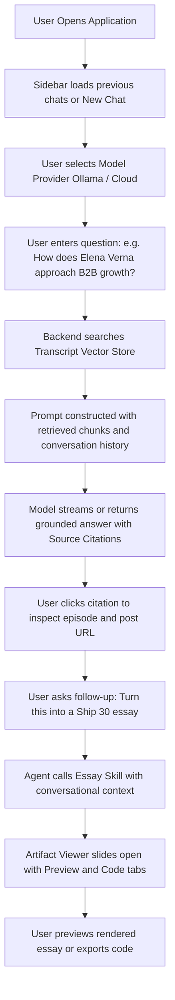

# Product Requirements Document (PRD)
## The Lenny Growth Assistant

**Document Status:** Candidate implementation baseline (some acceptance criteria still require live verification)  
**Author:** Candidate submission  
**Version:** 1.0.0  
**Target Audience:** Product Managers, Growth Leads, Founders, and Engineering Students

---

## 1. Problem Statement
Lenny Rachitsky's podcast and newsletter archive contains over 300 in-depth conversations with the world's best product leaders, startup founders, and growth experts (e.g., Elena Verna, Marc Andreessen, Eric Ries, Brian Halligan, Tony Fadell). However:
1. **Information Retrieval Friction:** Finding actionable, specific frameworks requires manual searching through hours of audio or thousands of transcript lines.
2. **Hallucination & Lack of Grounding in Generic LLMs:** Standard AI chatbots hallucinate quotes, guess episode advice, and lack source attribution back to specific podcast interviews.
3. **Synthesis & Content Creation Gap:** Product managers need to translate podcast insights into skimmable, viral-format executive summaries (such as Ship 30 for 30 atomic essays) or tangible web artifacts (roadmaps, feature comparison matrices, calculators) without losing context.
4. **Vendor Lock-in & Privacy Needs:** Teams need flexibility to run locally using open-source models via Ollama (zero API costs, offline privacy) or switch to high-powered cloud LLMs (OpenAI, Anthropic).

## 2. Target Users
* **Product Managers (PMs):** Seeking validated advice on roadmapping, retention loops, activation, pricing, and 0-to-1 PM practices.
* **Growth Engineers & Growth Leads:** Looking for tactical B2B/B2C growth playbooks, viral loops, and enterprise sales strategies.
* **Founders & Operators:** Seeking lessons on finding Product-Market Fit (PMF), hiring executives, and avoiding early-stage pitfalls.
* **Engineering Students & Beginners:** Studying how modern, production-grade full-stack AI applications are designed, architected, and tested.

## 3. User Needs and Key Use Cases
1. **Grounded Question Answering:** Ask questions like *"What is Elena Verna's playbook for B2B freemium growth?"* and receive precise answers with direct episode citations, timestamps, and quotes.
2. **Context-Preserved Follow-ups:** Ask follow-up queries (*"How does that contrast with Brian Halligan's inbound flywheel?"*) while preserving the conversational context.
3. **Session & History Management:** Organize research across multiple named sessions; rename, delete, and switch conversations without losing context.
4. **Ship 30 for 30 Essay Generation:** Transform conversational research into a ~1,250-word structured essay adhering to Dickie Bush and Nicolas Cole's high-retention frameworks.
5. **Interactive Artifact Generation:** Generate Markdown documents (specs, tables) and HTML/CSS web components (interactive calculators, pricing grids) with live, secure preview.
6. **Model Flexibility:** Seamlessly switch between local Ollama models (e.g., Llama 3.2 / Mistral) and cloud providers (OpenAI GPT-4o / Anthropic Claude 3.5 Sonnet) from the UI.

## 4. Proposed Solution
**The Lenny Growth Assistant** is an end-to-end, full-stack AI SaaS application combining:
* **Frontend:** A responsive React + TypeScript workspace with Tailwind CSS, featuring a deep navy sidebar, clean light chat workspace, and a collapsible, sandboxed Artifact Viewer.
* **Backend:** A high-performance FastAPI service with Pydantic validation, modular router design, and comprehensive OpenAPI documentation.
* **Database & Persistence:** PostgreSQL support through SQLAlchemy; local development can use SQLite by setting `DATABASE_URL`, and schema initialization currently uses SQLAlchemy `create_all` at startup while Alembic migration files are provided.
* **RAG Engine:** Ingestion pipeline parsing the available public starter corpus (about 50 podcast transcripts), metadata normalization, transcript chunking, feature-hash index persistence, IDF-weighted lexical retrieval, and citation tracking. Live retrieval prioritizes explainable token overlap and abstains when evidence is insufficient.
* **Agent System & Router:** An agent routing architecture separating retrieval, essay creation, and artifact generation with tool abstractions and model-provider agnostic adapters.
* **Artifact Sandbox:** A secure iframe container enforcing strict isolation policies for rendering untrusted generated HTML/CSS.

## 5. Success Metrics

### Measurable Metric Definitions
| Metric Category | Target Objective | Evaluation Methodology | Proposed Target | Current Status |
| :--- | :--- | :--- | :--- | :--- |
| **Grounded Retrieval Precision** | Relevant chunks retrieved in Top-3 | Manually score 10 benchmark questions against known transcript evidence | $\ge 85\%$ | Not benchmarked; automated lexical/off-topic tests only |
| **Hallucination Prevention** | No fabricated podcast citations | Manually review source metadata for 10 canonical questions | $100\%$ citations trace to returned sources | Not benchmarked end-to-end |
| **Session Isolation** | No cross-thread message leakage | Pytest verifies messages stay in their conversation | $100\%$ test pass rate | Backend test passes; no per-user auth/ownership controls |
| **Essay Word Count Fidelity** | Adherence to target length | Measure word count for 5 provider-generated essays | $1,250 \pm 15\%$ words | Live/provider evaluation pending |
| **Artifact Security Sandbox** | Parent DOM isolation for generated HTML | Verify sandbox flags and manually test hostile artifact payloads | No access to host origin/cookies | Sandbox/CSP configured; hostile-payload test pending |
| **Local Response Latency** | First-token response time | Benchmark on the target machine using Ollama | $< 5.0\text{ s}$ TTFT | Not measured in this review |

These are proposed targets, not reported results. Update the status column only after running and recording each measurement.

## 6. Assumptions
* A collection of real Lenny Rachitsky podcast transcripts (Markdown files with structured frontmatter) is available and indexed locally.
* On Windows development machines with 16 GB RAM, local quantized models (e.g., Llama 3.2 3B or Qwen 2.5 7B via Ollama) can run comfortably alongside the web server and browser.
* If the selected provider or its key is unavailable, the application returns a clear retry/error response rather than silently substituting a different model.

## 7. Scope Boundaries

### In-Scope
* Clean, responsive React + TypeScript + Tailwind single-page app.
* Transcript RAG pipeline indexing the available public starter set (about 50 podcast transcripts).
* Verifiable source citations (guest name, episode title, transcript section, URL).
* Multi-conversation persistence (create, read, rename, delete).
* Model provider toggle (Ollama local model vs. Cloud LLM).
* Ship 30 for 30 structured essay generation tool.
* Markdown and HTML/CSS artifact generation with Code and Preview tabs.
* Iframe sandboxing with security boundaries.
* Comprehensive unit and integration test suite with Pytest.
* Complete beginner learning guide (`LEARNING_GUIDE.md`).

### Out-of-Scope (for Version 1.0)
* Multi-user OAuth login / JWT authentication (V1 uses deterministic session identifiers / local user profile).
* Audio playback synchronization with transcripts.
* Real-time automated scraping of newly released episodes.

## 8. Functional Requirements
1. **FR-1 Health Check:** `GET /api/health` returning system status, DB connection status, active provider, and indexed document count.
2. **FR-2 Session CRUD:** Endpoints to list, create, fetch, rename, and delete conversation threads.
3. **FR-3 Chat Execution:** `POST /api/chat` supporting conversational streaming or structured payload with conversation ID, model provider, and message text.
4. **FR-4 Grounded RAG Retrieval:** Query matcher searching transcript index and injecting top-k chunks with provenance into the prompt context.
5. **FR-5 Citations:** Response payload includes structured sources list with episode title, guest name, post URL, and excerpt.
6. **FR-6 Provider Switching:** Ability to query available models (`GET /api/models`) and specify provider (`ollama`, `openai`, `anthropic`).
7. **FR-7 Essay Generation:** Dedicated skill endpoint `POST /api/skills/essay` generating ~1,250-word structured essays following Ship 30 for 30 principles.
8. **FR-8 Artifact Generation & Storage:** `POST /api/artifacts` creating HTML or Markdown artifacts linked to the conversation, with retrieval endpoints.
9. **FR-9 Artifact Viewer:** Frontend tabbed panel rendering preview in an isolated iframe, with code copy and file download triggers.

## 9. Non-Functional Requirements
* **Simplicity & Readability:** Clean Python and TypeScript code; no convoluted abstractions; rich comments.
* **Security:** Model-generated HTML rendered in a sandboxed iframe without `allow-same-origin`, preventing DOM access or cookie theft.
* **Resilience:** Graceful error messages when Ollama is offline or API keys are missing.
* **Performance:** Vector retrieval in under 150ms on local CPU.
* **Accessibility:** Contrast ratios complying with WCAG AA; keyboard navigable sidebar and inputs.

## 10. User Journey Walkthrough

## 11. Acceptance Criteria and Verification Status

Do not treat unverified UI/provider behavior as complete. This review confirms backend unit tests only; live provider, browser, and cloud checks remain to be recorded after deployment.

* [ ] Grounded answers are accurate across a manually scored set of transcript questions, with source URLs/excerpts checked.
* [ ] Follow-up questions preserve context during a live-provider UI test.
* [x] Backend test verifies that messages from separate conversation IDs do not leak between those conversations.
* [x] Conversation persistence/CRUD endpoints are covered by backend tests.
* [ ] Ollama, OpenAI, and Anthropic selection have each been tested against working providers in the UI.
* [ ] Generated essays have been checked for grounding, structure, and the 1,100–1,400-word target using a real provider.
* [ ] Markdown and HTML artifact previews have passed browser-level testing, including a hostile HTML smoke test.
* [x] Backend pytest suite: 13 tests pass in the available test environment.
* [x] PRD, architecture, design, README, learning guide, deployment guide, and manual test plan are included.
* [ ] Clean Linux Docker build and live Railway health/UI checks completed.

---
